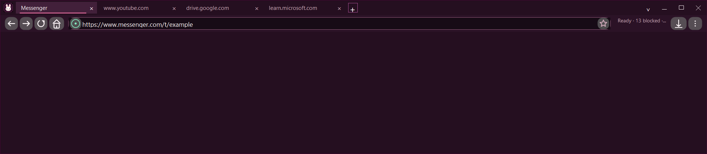

# MishaWeb

> [!WARNING]
> **Windows only. There is no macOS or Linux build, and one is not planned for the 2.x line.**
> MishaWeb is built on Windows Forms and the Microsoft Edge WebView2 Evergreen Runtime. Windows Forms has no macOS runtime, and WebView2 does not ship for macOS at all, so this project cannot be compiled or run on a Mac. A macOS edition would have to replace both the UI framework and the rendering engine, and would need a separate ad-blocking implementation built on WebKit's content-rule format rather than the ABP/uBO syntax this engine compiles.

A lightweight Windows desktop browser shell in C# (.NET 10 LTS WinForms) hosting Microsoft Edge WebView2 Evergreen, featuring custom ad blocking, Multi-View split panes, 3-tier tab memory management, CRX extension loading, and local/live address suggestions.

[](https://github.com/MishaelOliva/MishaWeb/actions/workflows/windows.yml)
[](https://github.com/MishaelOliva/MishaWeb/releases/latest)
[](https://github.com/MishaelOliva/MishaWeb)
[](https://dotnet.microsoft.com/download/dotnet/10.0)
[](LICENSE)



## What it does

- **Web browsing via WebView2**: Embeds the Microsoft Edge WebView2 Evergreen Runtime to render HTML5, CSS, and WebAssembly with hardware acceleration without bundling a full Chromium distribution.
- **Multi-View split workspace**: Supports `Single`, `Split` (2-pane), `Tri` (3-pane), and `Quad` (4-pane) layouts inside a single window with draggable horizontal and vertical splitters, per-pane headers, unique pane-to-tab assignment, and persisted split ratios.
- **Ad and tracker blocking**: Compiles filter rules from 20 catalog sources (EasyList, EasyPrivacy, uBlock Origin, and Brave lists) into an in-memory index with a binary snapshot cache (`compiled-rules-v1.bin`), per-request rule attribution, host-keyed cosmetic CSS caching, and split universal/YouTube document-start scripts.
- **Tab lifecycle management**: Uses a 3-tier memory policy (active and MRU resident set, low-memory background targets, and idle tab sleep/discard) to limit memory growth during long browsing sessions, while keeping visible Multi-View panes, audible tabs, active calls, and downloads awake.
- **Extension support**: Ingests Chrome Web Store URLs/IDs, signed CRX3/CRX2 packages, and unpacked ZIP/folder extensions with publisher proof validation, manifest permission review, update checks, and isolated InPrivate profiles.
- **Downloads and notifications**: Anchors a non-activating download toast beneath the toolbar Downloads button with live progress, **Open** / **Show in folder** / **Cancel** actions, high-risk executable prompts, and persisted recent download history.
- **Address and open-tab suggestions**: Indexes local history, favorites, and open tabs (`Switch to tab`) with low allocation overhead, alongside optional debounced live search suggestions, tab favicons, clickable tab audio-mute indicators, Picture-in-Picture, and dependency-free reader mode.

## Architecture / How it works

MishaWeb separates the desktop user interface and background subsystems from the browser rendering engine:

```
+-------------------------------------------------------------+
|                     MISHAWEB DESKTOP HOST                   |
|                 (C# 14 / .NET 10 LTS WinForms)              |
+-------------------------------------------------------------+
       |                                     |
       v                                     v
+-----------------------------+   +---------------------------+
|      NATIVE WINFORMS UI     |   |   CORE SUBSYSTEMS (C#)    |
| - Double-buffered GDI+ tab  |   | - AdBlockEngine           |
|   strip, command bar &      |   | - TabLifecyclePolicy      |
|   Multi-View split panes    |   | - MultiViewLayoutEngine   |
| - Download toast & dialogs  |   | - AddressSuggestionEngine |
| - Native start page         |   | - BrowserExtensions (CRX) |
+-----------------------------+   +---------------------------+
       |                                     |
       +----------------------+--------------+
                              |
                              v
       +---------------------------------------------+
       |      MICROSOFT EDGE WEBVIEW2 EVERGREEN      |
       | - CoreWebView2 Environment & Profiles       |
       | - Standard profile vs InPrivate UDF         |
       | - Resource requested network filtering      |
       | - Document-start script & CSS injection     |
       +---------------------------------------------+
```

Instead of packaging Chromium and Node.js binaries (like Electron), MishaWeb relies on the OS-installed Edge WebView2 runtime. This produces a 4.19 MB framework-dependent executable (`MishaWeb.exe`) or a 53.25 MB compressed self-contained single-file executable with .NET 10 bundled.

## Quick start

### Option 1: Download Prebuilt Release (No .NET Install Required)

1. Download **`MishaWeb-v2.5.1-win-x64.zip`** from the [Latest Release](https://github.com/MishaelOliva/MishaWeb/releases/latest).
2. Extract the zip archive and open the extracted folder.
3. Double-click **`MishaWeb.exe`** to launch directly (the release zip bundles .NET 10, so only Windows 10/11 x64 and the pre-installed Edge WebView2 Runtime are required).

### Option 2: Build and Run from Source

#### Prerequisites

- Windows 10 or Windows 11 (x64). There is no other supported operating system.
- [.NET 10.0 SDK](https://dotnet.microsoft.com/download/dotnet/10.0) (10.0.103+ pinned in `global.json`)
- [Microsoft Edge WebView2 Runtime](https://developer.microsoft.com/en-us/microsoft-edge/webview2/) (pre-installed on modern Windows)
- Node.js (for running the `.mjs` contract and script regression tests)

```powershell
git clone https://github.com/MishaelOliva/MishaWeb.git
cd MishaWeb

# Restore locked dependencies
dotnet restore desktop.tests/MishaWeb.SmokeTests.csproj --locked-mode

# Run the desktop application
dotnet run --project desktop/MishaWeb.csproj --configuration Release
```

## Configuration

| Setting / Shortcut | Description | Default Location |
| :--- | :--- | :--- |
| Standard Profile | WebView2 cookies, cache, and site storage | `%LOCALAPPDATA%\MishaWeb\WebView2` |
| Browser Settings & State | Tabs, Multi-View layout, bookmarks, history, permissions, and recent downloads | `%LOCALAPPDATA%\MishaWeb\settings.json` |
| InPrivate Mode (`Ctrl+Shift+N`) | Opens an ephemeral window with isolated storage and no extensions | Temporary directory, deleted on close |
| Extension Storage | Managed CRX/unpacked extension payloads and user scripts | `%LOCALAPPDATA%\MishaWeb\Extensions` |
| Filter Catalog & Snapshot | Cached filter lists and binary compiled rule snapshot (`compiled-rules-v1.bin`) | `%LOCALAPPDATA%\MishaWeb\Filters` |
| Diagnostics & Crash Logs | Rotating operational log and unhandled-exception log | `%LOCALAPPDATA%\MishaWeb\diagnostics.log` |

## Testing

Verification runs both the C# smoke/policy test runner (`desktop.tests/Program.cs`, 661 checks) and five Node contract/script suites (`ProbeLaunchContract.test.mjs`, `MemoryChurnAnalysis.test.mjs`, `MemoryAcceptanceProbe.test.mjs`, `ReaderModeScript.test.mjs`, and `AdBlockDocumentScript.test.mjs`), plus `desktop.tests/PublishTransactionSmoke.ps1`:

```powershell
# Run locked restore, strict -warnaserror build, 5 Node contract tests, and 661 C# smoke checks
npm run desktop:check

# Or run the C# smoke test project directly (also executes the 5 Node tests via MSBuild target)
dotnet run --project desktop.tests/MishaWeb.SmokeTests.csproj --configuration Release
```

Release builds are verified with `--warnaserror` across all projects and packaged via `build/Publish-MishaWeb.ps1` (`FrameworkDependent`, `OneClick`, and `Portable` modes).

## Known limitations

- **Windows only**: Built on Windows Forms and Microsoft Edge WebView2; cannot run on macOS or Linux. See the warning at the top of this file for what a macOS edition would require.
- **Runtime dependency**: Requires Microsoft Edge WebView2 Evergreen Runtime present on the system.
- **Ad blocker scope**: Network filtering intercepts requests exposed through WebView2 APIs, and cosmetic filtering injects CSS rules at document start. It does not execute arbitrary procedural scriptlet injection.
- **Ad blocker response rewrites**: Rules carrying `$redirect=`, `$redirect-rule=`, `$empty`, `$mp4`, `$all` and `$priority=` are dropped rather than applied. A rewrite has no meaning in an engine that cancels requests, and honouring one as a block would turn a pixel swap into a broken image. Those requests are therefore *not* blocked, and the rule's protection is lost.

## License

This project is licensed under the [MIT License](LICENSE). Third-party library notices and upstream filter list licenses are documented in [`licenses/THIRD-PARTY-NOTICES.txt`](licenses/THIRD-PARTY-NOTICES.txt).

---
*Built by [Mishael Oliva](https://github.com/MishaelOliva) • [LinkedIn](https://www.linkedin.com/in/mishael-oliva-96a31b3a2)*
